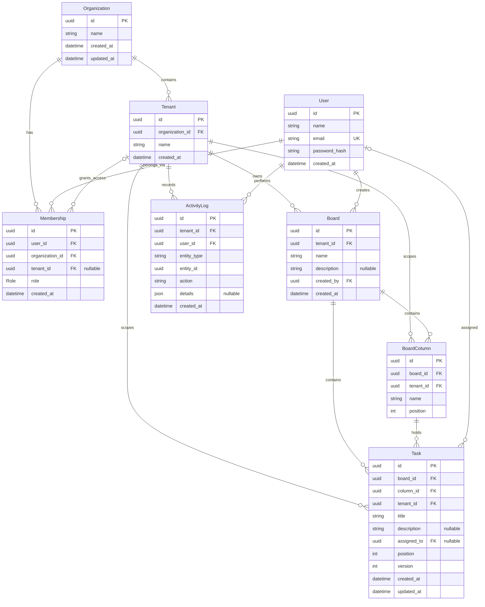

# JulleyOnline — Database ER Diagram

## Entity Relationship Diagram

The following diagram represents the PostgreSQL database structure used by the JulleyOnline multi-tenant collaborative Kanban application.



---

## Database Overview

JulleyOnline uses PostgreSQL with Prisma ORM and a shared-schema multi-tenant architecture.

The database includes eight models:

| Model | Responsibility |
|---|---|
| Organization | Stores organizations |
| Tenant | Represents organization workspaces |
| User | Stores registered users |
| Membership | Assigns organization and tenant roles |
| Board | Represents Kanban boards |
| BoardColumn | Stores board workflow columns |
| Task | Stores tasks, positions, and versions |
| ActivityLog | Records task activity |

## Membership Model

The Membership model connects users to organizations and tenants.

Supported roles:

- `ORG_ADMIN`
- `TENANT_ADMIN`
- `MEMBER`

### Organization-Level Membership

An organization administrator has a membership with:

```text
organization_id = ORGANIZATION_UUID
tenant_id = NULL
role = ORG_ADMIN
```

This allows organization-wide authorization through the backend membership middleware.

### Tenant-Level Membership

Tenant administrators and members have:

```text
organization_id = ORGANIZATION_UUID
tenant_id = TENANT_UUID
role = TENANT_ADMIN or MEMBER
```

The tenant relationship is optional because organization-wide memberships do not reference a specific tenant.

## Database Uniqueness Constraints

In addition to primary keys and Prisma-defined unique constraints, the database includes PostgreSQL partial unique indexes.

### Unique Tenant Membership

```sql
CREATE UNIQUE INDEX "membership_unique_tenant_user"
ON "memberships" (
  "user_id",
  "organization_id",
  "tenant_id"
)
WHERE "tenant_id" IS NOT NULL;
```

This ensures a user cannot have duplicate memberships within the same tenant.

### Unique Organization Membership

```sql
CREATE UNIQUE INDEX "membership_unique_org_user"
ON "memberships" (
  "user_id",
  "organization_id"
)
WHERE "tenant_id" IS NULL;
```

This prevents duplicate organization-wide memberships for the same user and organization.

These partial unique indexes are maintained through a SQL migration because the membership scope depends on whether `tenant_id` is null.

## Referential Integrity

The database uses composite relationships to preserve tenant and board consistency.

Examples include:

- Tenant references its organization.
- Membership references its organization and optionally a tenant within that organization.
- BoardColumn references a board within its tenant.
- Task references a board within its tenant.
- Task references a column within its board and tenant.

These constraints reduce the risk of invalid cross-tenant relationships.

## Task Concurrency

Each task includes:

- `position` for ordering within a column.
- `version` for optimistic concurrency control.

Task movement uses PostgreSQL transactions, board-row locking, and Serializable isolation.

Outdated task updates or movements can return HTTP 409 Conflict.

## Related Documentation

- [Database Architecture](database-architecture.md)
- [REST API Documentation](api-documentation.md)
- [WebSocket Documentation](websocket-documentation.md)
```
